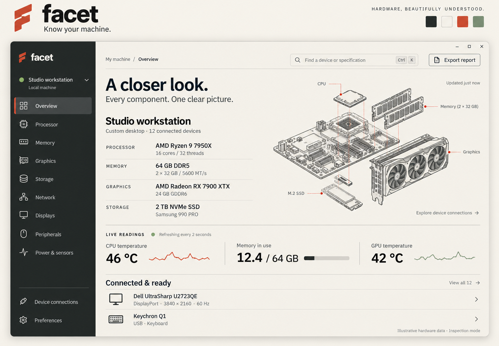

# Facet: proposed brand and visual concept

## Brand

**Name:** Facet, styled as lowercase `facet` in the wordmark.

**Tagline:** Know your machine.

The name refers to revealing the different facets of a machine's hardware. It is a proposed creative direction, not a confirmed final name or a claim of trademark availability.

**Character:** warm, intelligent, precise, approachable, quietly distinctive.

**Mark:** an angular lowercase-f abstraction built from cut planes.

## Visual language

An editorial technical instrument: confident typography, carefully aligned specifications, generous whitespace, hairline dividers, crisp line icons, and detailed engineering illustrations. Avoid a generic dashboard grid, neon effects, glassmorphism, or decorative visual noise.

| Role | Proposed color |
| --- | --- |
| Main surface | Warm ivory `#F4F1EA` |
| Primary text | Graphite `#252726` |
| Navigation | Deep graphite `#202523` |
| Accent | Vermilion `#D84B33` |
| Supporting accent | Muted sage `#78917C` |

Typography direction: a refined sans serif similar to IBM Plex Sans, with IBM Plex Mono selectively used for identifiers and measurements. Final font selection and contrast validation are implementation work.

The application owns its styling. Do not integrate Omarchy themes or inherit distribution-specific branding. Light and dark variants have not both been designed; the current concept uses an ivory content area and graphite sidebar.

## Overview composition

- Graphite sidebar with machine identity and navigation: Overview, Processor, Memory, Graphics, Storage, Network, Displays, Peripherals, Power & sensors.
- Secondary navigation for Device connections and Preferences.
- Toolbar with breadcrumb, search and Ctrl+K hint, and Export report.
- Main heading: “A closer look.” Supporting line: “Every component. One clear picture.”
- Machine summary with processor, memory, graphics, and storage specifications.
- A contained exploded hardware illustration with connection exploration entry point.
- Unboxed live readings for CPU temperature, memory use, and GPU temperature.
- Connected-device rows with concise connection specifications.

Component pages should lead with a readable summary, followed by grouped specifications and expandable technical information. A connection view should reveal relationships such as devices through hubs and docks or drives behind controllers.

## Delight and usability

- Click to copy model numbers and other useful values.
- Preserve the selected device and reading position during refresh.
- Gently highlight new devices after hotplug.
- Remember the last visited page.
- Make search work for model, manufacturer, identifier, and plain-language properties.
- Keep motion subtle and respect reduced-motion preferences.
- Adapt gracefully to small tiled windows and fractional scaling.
- Provide keyboard navigation, visible focus, and accessible names.

## Mock-up

The image combines a brand presentation band with the application overview. The outer brand band is presentation material, not part of the application window.

Generated with the built-in image generator. [Exact generation prompt](assets/facet-image-prompt.txt).

The hardware data, temperatures, connected-device count, and component illustration are illustrative. The drawing is a visual metaphor, not a measured physical reconstruction. The mock-up is not functional software and does not prove accessibility, performance, or data availability.
